# Salesforce Org Compare

[](https://chromewebstore.google.com/detail/salesforce-org-compare/mpocihehhnklfhplkdlmahmopinjnpcg)
[](https://chromewebstore.google.com/detail/salesforce-org-compare/mpocihehhnklfhplkdlmahmopinjnpcg)
[](https://chromewebstore.google.com/detail/salesforce-org-compare/mpocihehhnklfhplkdlmahmopinjnpcg)
[](LICENSE)
[](https://salesforceorgcompare.com/)

**Compare, test, debug and manage Salesforce orgs with the browser session you already have — no Salesforce CLI, no Connected App, no API keys.**

[Website](https://salesforceorgcompare.com/) · [Privacy](PRIVACY.md) · Built for admins, developers, and release managers who live in multiple orgs every day.

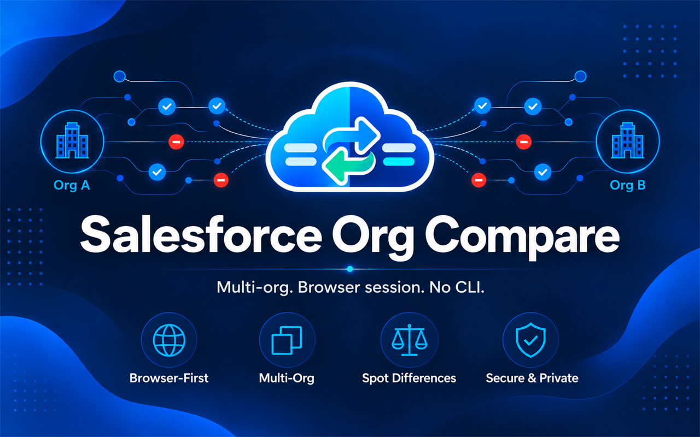

---

## Why teams choose the browser

Skip Connected Apps, API keys, and CLI installs for day-to-day compare and debug work. Use the Salesforce session you already have open in Chrome.

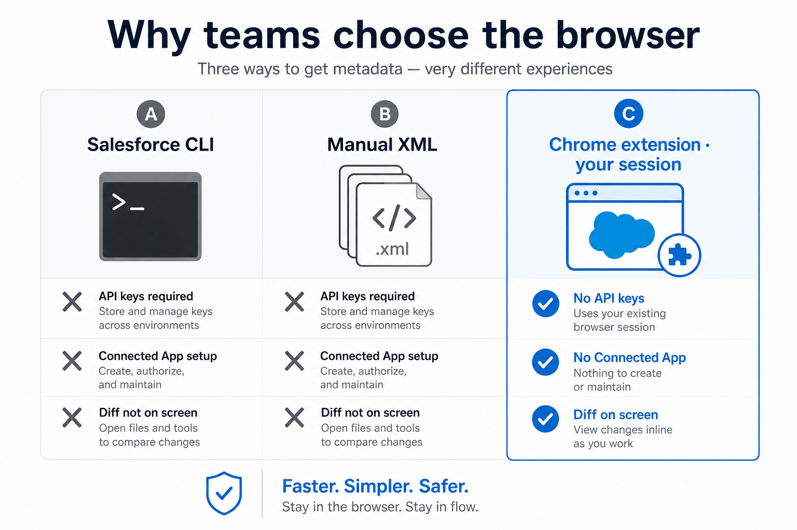

| | |
|---|---|
| **Your session, not new credentials** | Reuses the Salesforce tab you already logged into |
| **Multi-org in one place** | Save PRO, UAT, and sandboxes with aliases and groups, and jump between them |
| **Diff on screen** | Metadata and code comparison — export HTML when you need a report |
| **A developer hub in Chrome** | Apex tests, SOQL, Quick Edit, REST, debug logs, data and permissions |
| **Safe by design** | Direct browser-to-Salesforce calls, your own permissions, per-org read-only mode |
| **Free** | Available on the Chrome Web Store, in English and Spanish |

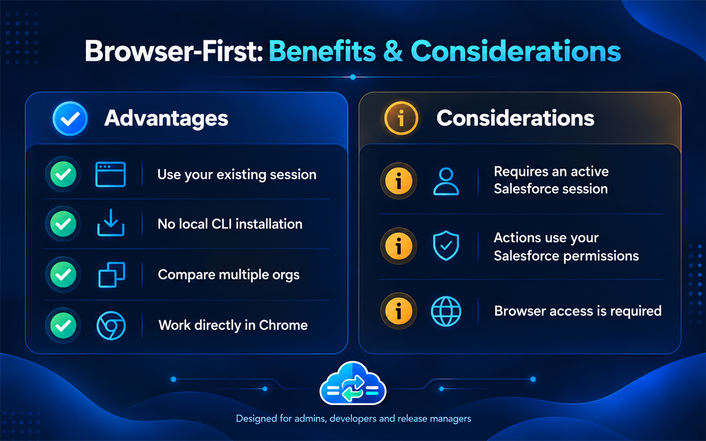

---

## How it works

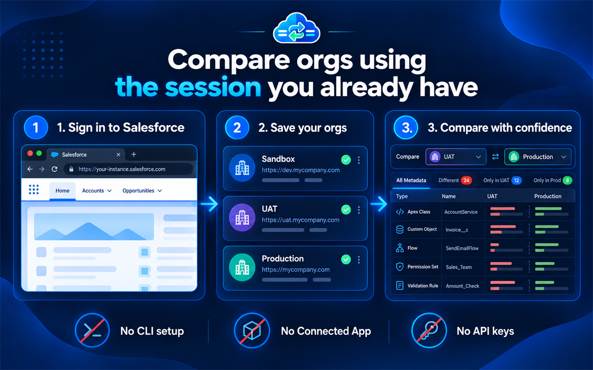

1. **Log into Salesforce** in Chrome.
2. **Save orgs** from the extension popup (aliases, groups).
3. **Compare, test, query, or debug** from the main app — or jump in from Setup when UI Integration is enabled.

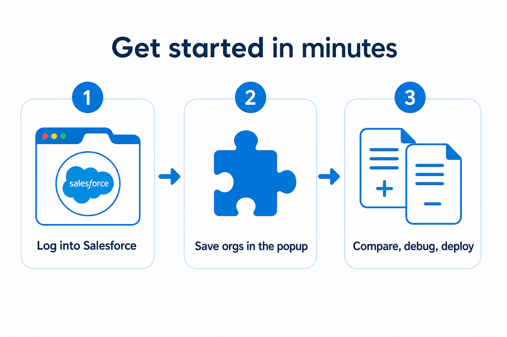

---

## One workspace for Salesforce operations

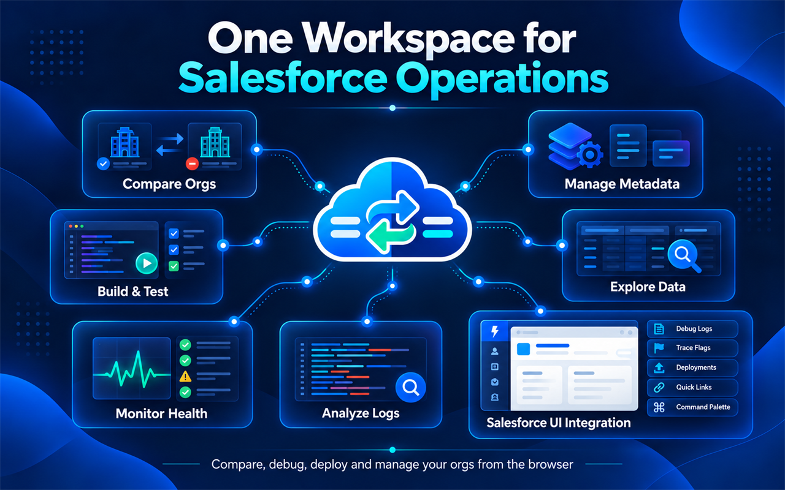

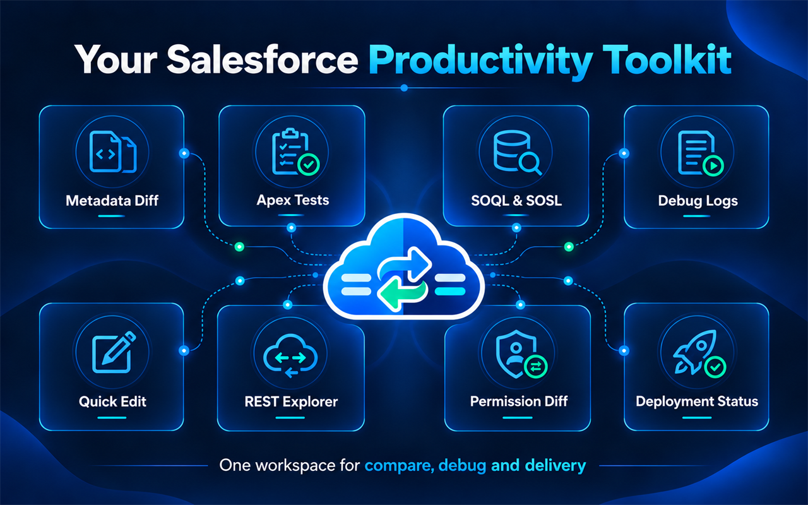

---

## Usage flows

### Compare orgs before a release

Sandbox → UAT → PRO: pull metadata, see what changed, ship with confidence.

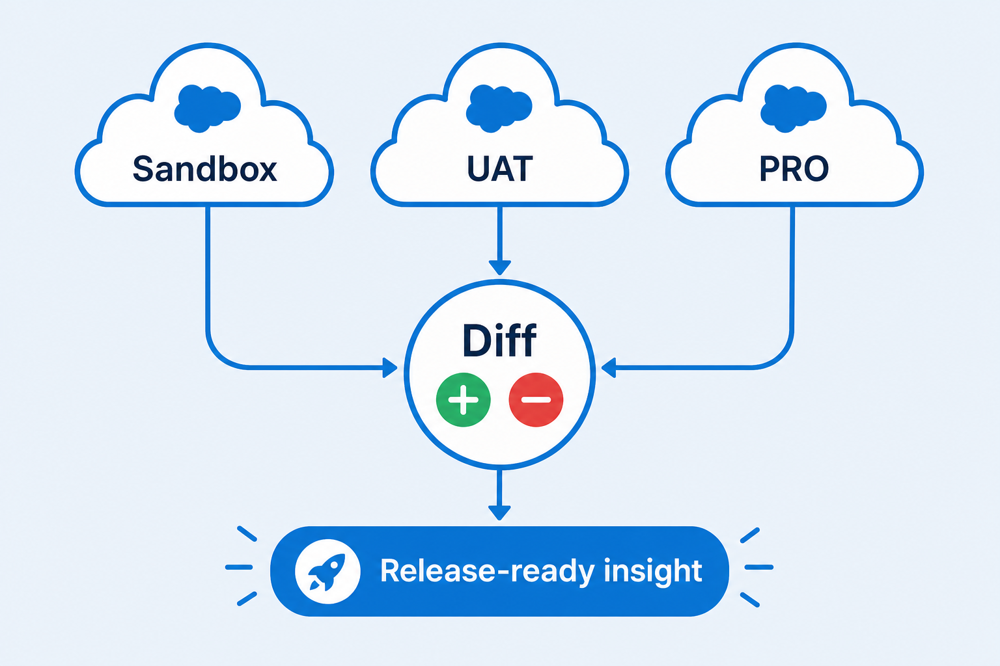

### Debug faster with Logi 

From a raw Apex debug log to parsed analysis to an optional AI assist (**Logi**: summarize, debug, suggest fixes). Free tier or BYOK OpenRouter. Opt-in.

Access is invite-only during beta — [request access](https://salesforceorgcompare.com/solicitar-acceso-logi/) with your installation ID (Settings → About).

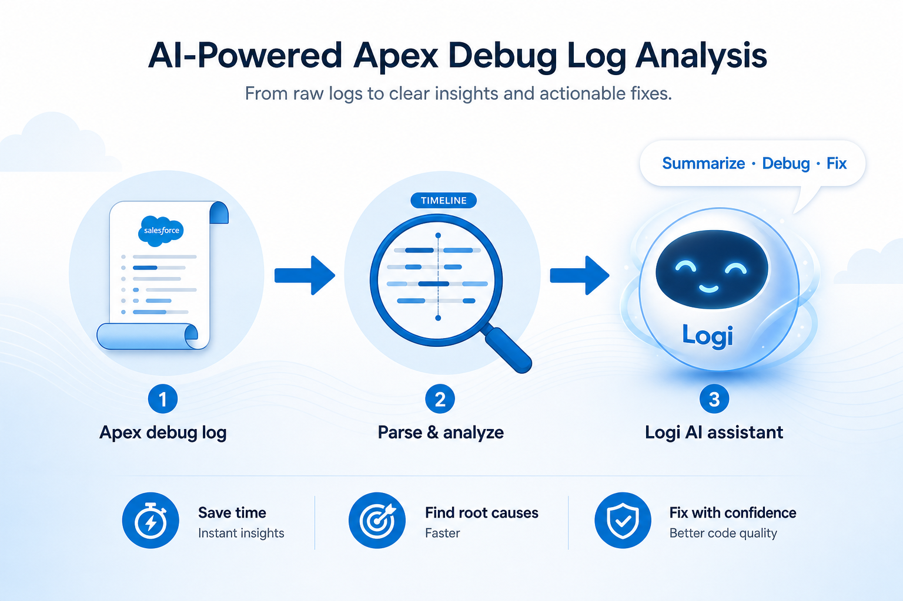

### Change access in bulk, with a preview 

Pick an object (and optionally a field), select any number of Profiles and Permission Sets, and queue the final state you want for each permission. Review the current-versus-final preview, then apply. A failure on one target does not stop the others, and you get an applied / unchanged / failed summary.

### Manage a user without leaving Setup 

Search for a user in the Setup Command Palette, open their summary, and manage permission sets, permission set groups, public-group membership, trace flags, profile data, passwords, and **Login As** — in the current tab, a new tab, or incognito.

### Salesforce UI Integration 

Bring SFOC into the Salesforce pages where you work. Enable the master switch and the capabilities you want in **Settings → Salesforce UI Integration**. Each capability is opt-in; actions that use Salesforce data require a saved org and an active Salesforce session. The deployment-source links can still be displayed before you select a saved target org.

#### Debug Logs, ready for analysis

Open a native Setup Debug Log in the SFOC Apex Log Viewer with one click. On the same page, place Debug Logs above User Trace Flags to reduce scrolling.

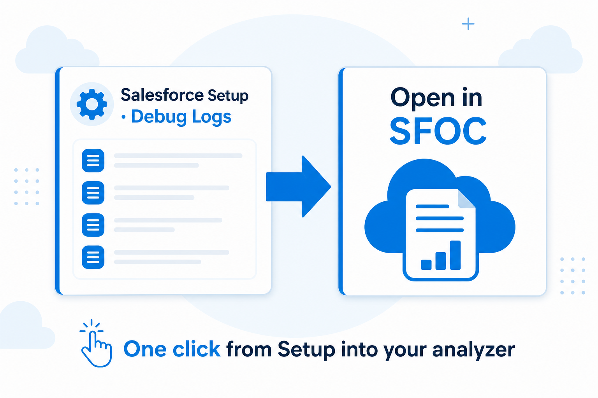

#### Keep User Trace Flags useful

Show the active and recently expired traces that matter, and extend or reactivate an eligible trace without leaving Setup.

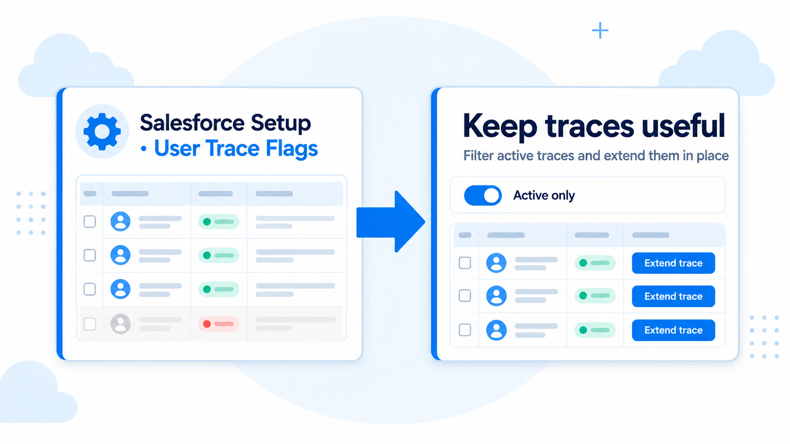

#### Understand failed deployments where they happen

Expand failed deployments for inline component and test errors. From the status page or the deployment-detail page, choose a saved org and Ctrl/Cmd-click an Apex reference to open its source in SFOC.

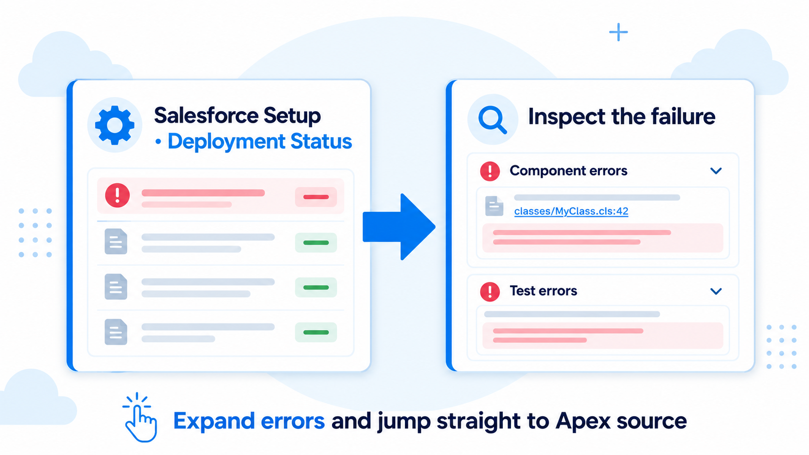

#### From deployment error to Apex source

On the deployment-detail page, select a saved org and Ctrl/Cmd-click a component, test, or stack-trace reference to open the relevant class directly in SFOC.

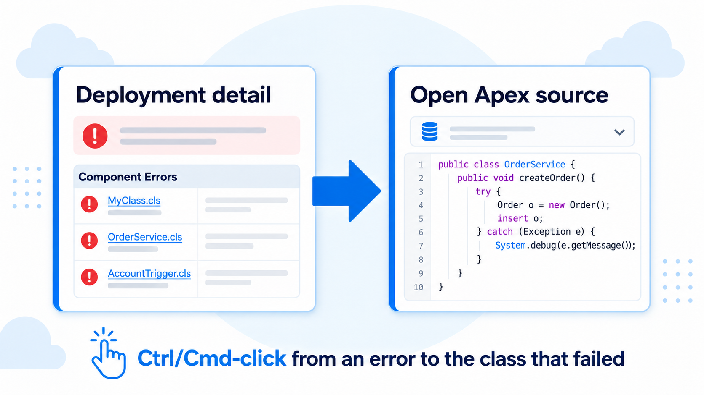

#### Your SFOC tools from any Lightning page

Add personal Quick Links in the global Lightning header for SFOC tools or same-org custom paths. Use the configurable Setup Command Palette shortcut (default `Ctrl+K`) to search Setup pages, configured links, saved scripts, SFOC tools, and users.

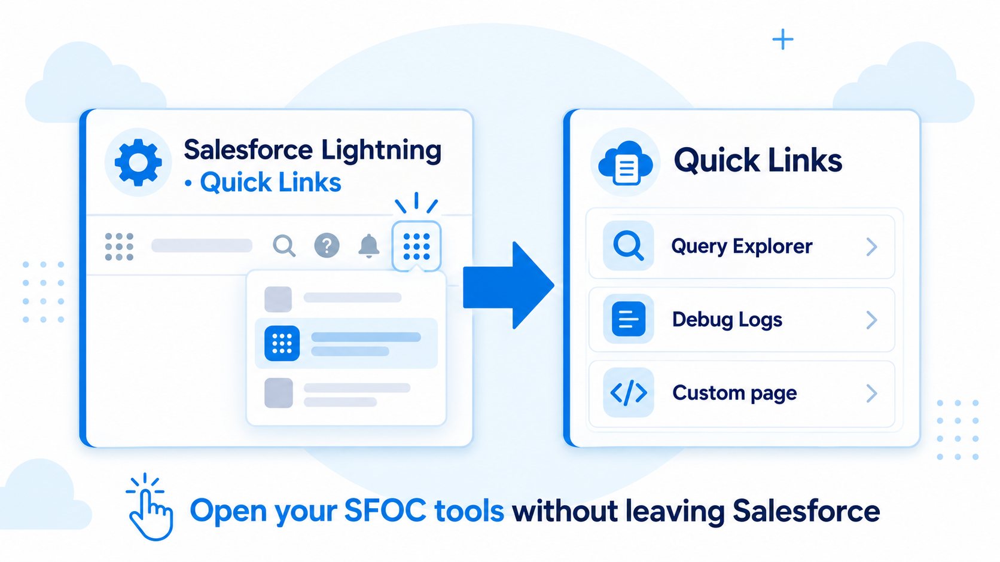

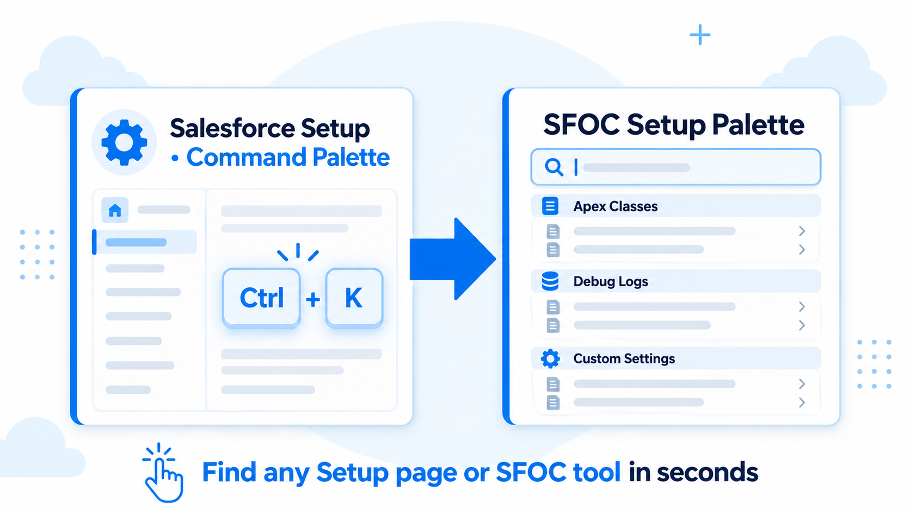

#### Run record actions without leaving the record

Create **Record Quick Actions** in Record Viewer to update one or more fields on the current record or a related record. Choose the environments where each action applies, then run it from the Salesforce **Quick Links** menu while viewing a record. The menu keeps Record Quick Actions separate from regular Quick Links, shows progress and a success notification, refreshes the record after completion, and provides a gear shortcut to edit the action.

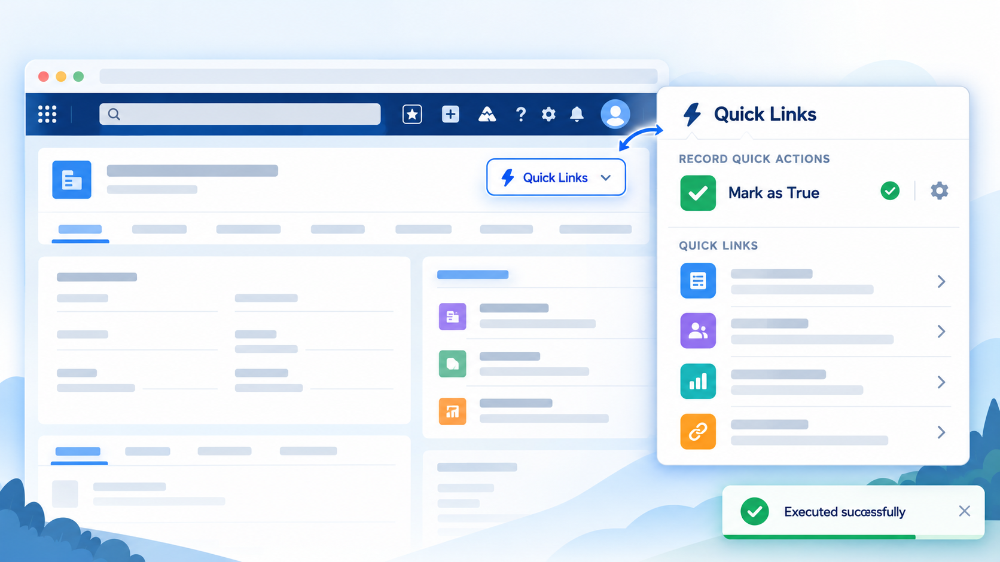

#### Open any record in View All Data & Editor

With the *View All Data & Editor* capability on, press the configurable shortcut (default `Ctrl+Shift+E`) on a Salesforce record page to open every field of the record in a dedicated SFOC tab — with object permissions and record access shown alongside.

> **Trademark notice:** Salesforce Org Compare is a third-party tool and is not affiliated with or endorsed by Salesforce, Inc.

---

## Table of contents

**Product**

- [Why teams choose the browser](#why-teams-choose-the-browser)
- [How it works](#how-it-works)
- [Usage flows](#usage-flows)
- [Features](#features)
- [What's new](#whats-new)

**Technical**

- [Security and Privacy](#security-and-privacy)
- [Technical Architecture](#technical-architecture)
- [Installation](#installation)
- [Troubleshooting](#troubleshooting)
- [Contributions](#contributions)
- [Development](#development)
- [Project Structure](#project-structure)
- [Documentation](#documentation)
- [Third-Party Libraries](#third-party-libraries)
- [About](#about)
- [License](#license)

---

## Features

### Metadata Comparator

- Search and index metadata across saved orgs
- Retrieve source and compare side by side with Monaco Editor
- Ignore whitespace-only changes and export diffs to HTML
- **Single view** to open a component in one org without diffing
- Pin items, reorder the compare list with drag and drop, and share deep links
- Support for Apex, LWC, Aura, Visualforce, Permission Sets, Profiles, FlexiPages, and any metadata type supported by retrieve / `package.xml`
- Persist compared items locally between sessions

### Workbench & productivity

- Workbench navigation — Home, Comparator, Development, Analysis, Monitoring, and Manifests — with favorites, recent tools, contextual actions, and guided onboarding tours
- Command palette to jump to tools, metadata, and saved scripts with `Ctrl/Cmd+K` (`Ctrl/Cmd+Shift+P` also works)
- Saved SOQL/SOSL queries, Anonymous Apex scripts, Apex test profiles, and pinned work items
- Configurable date and time display format
- Backup and restore for orgs, preferences, favorites, saved work, queries, scripts, test profiles, and Record Quick Actions. New backups use the `.sfocbackup` format with light `sfoc` obfuscation; legacy JSON backups can still be imported.

### Development

| Tool | Description |
|------|-------------|
| **Apex Tests** | Run tests by class or method with independent filters and a selection summary; reuse named test profiles; track jobs; copy failures or job Ids; see the slowest methods; open or download run logs, singly or as a ZIP |
| **Apex Coverage Compare** | Compare coverage between orgs, with class deltas and line-level viewers |
| **Quick Edit** | Retrieve, edit, validate, and deploy Apex or Visualforce source |
| **Lightning Quick Edit** | Retrieve, edit, validate, and deploy LWC and Aura bundles |
| **Anonymous Apex** | Execute and keep reusable scripts; open or download the resulting log |
| **Query Explorer** | Build, run, save, and share SOQL or SOSL (REST or Tooling API), compare results across orgs, export CSV/JSON, and send results to Data Workbench |
| **REST Explorer** | Interact with Salesforce REST APIs using the org session |
| **Debug Log Browser** | Filter by date, user, and operation; manage traces; open, analyze locally, download, or ZIP selected logs; bulk-delete |
| **Event Monitor** | Subscribe to Platform Events and Change Events with configurable replay |
| **Data Workbench** | Edit records field by field, or import CSV, Excel, or JSON with column mapping and insert / update / upsert / delete |
| **Object & Field Access**  | Grant or revoke object and field permissions across many Profiles and Permission Sets with queue, preview, and per-target results |

### Analysis

| Tool | Description |
|------|-------------|
| **Permission Diff** | Compare Profiles and Permission Sets (Object, Field, and Setup sections), or compare the effective permissions of two users |
| **Field Dependency** | Explore dependent-picklist relationships |
| **Dependency Explorer** | Analyze metadata dependencies and their graph |
| **Object Describe** | Inspect object and field metadata |
| **Custom Settings Compare** | Diff custom settings across orgs |
| **Custom Metadata Compare** | Diff custom metadata types |
| **Record Compare** | Compare individual records |

### Monitoring

| Tool | Description |
|------|-------------|
| **Environment Status** | Review Trust status, instance health, and environment signals |
| **Health Monitor** | On-demand environment diagnostic with a health score, critical limits, Apex coverage, async and scheduled-job failures, and PDF export |
| **Org Limits** | Review org limits, consumption, and warning thresholds |
| **Deploy Status** | Track deployments, read errors inline, inspect executed tests and coverage |
| **Bulk Job Monitor** | Monitor Bulk API v1/v2 jobs and download result files |
| **Setup Audit Trail** | Review setup change history |
| **Field History** | Inspect field history tracking |

### Manifests

| Tool | Description |
|------|-------------|
| **Generate Package.xml** | Build `package.xml` from selected metadata |
| **Metadata Type Compare** | Compare all members of a metadata type |

### Standalone Viewers

- **Apex Log Viewer** — execution tree, timeline, SOQL, DML, limits, callouts, profiling, validations, workflow, and errors; compare two logs; export timeline data as CSV or JSON
- **Logi**  — optional AI advisor inside the Apex Log Viewer (summarize, chat, quick actions). [Request beta access](https://salesforceorgcompare.com/solicitar-acceso-logi/).
- **Apex Coverage Viewer** — coverage visualization, using the archived deployment package when available
- **Apex Source Viewer** — focused, multi-tab Apex source inspection with symbol navigation
- **Record Viewer (View All Data & Editor)** — all fields of a record with object permissions and record access, inline editing, clone, delete, and Record Quick Actions
- **Health Monitor** — full-page environment diagnostic opened from Environment Status

### Salesforce UI Integration (`sfInject`)

- **Debug Logs:** Open each native Setup log in the Apex Log Viewer and optionally place Debug Logs above User Trace Flags.
- **User Trace Flags:** Filter to relevant active/recently expired traces and extend or reactivate eligible user traces.
- **Deployments:** Expand errors inline; select an org and Ctrl/Cmd-click Apex references in status or deployment-detail errors to open source in SFOC.
- **Quick Links and Record Quick Actions:** Add a global Lightning-header menu for SFOC tools and same-org custom URLs. On record pages, available Record Quick Actions appear in their own section, can be executed directly, and expose a configuration shortcut.
- **Setup Command Palette:** Use a configurable shortcut (default `Ctrl+K`) to search Setup, Quick Links, saved scripts, SFOC tools, and users. From a user result you can review the summary, manage permission sets, permission set groups, and public-group membership, enable or renew debug logs, edit selected user fields, set a password, or start **Login As**.
- **View All Data & Editor:** Open the current record in Record Viewer with a configurable shortcut (default `Ctrl+Shift+E`).

### Popup & Settings

- Manage saved orgs (aliases, groups, drag-and-drop ordering), with session status at a glance
- Mark any org as **read-only** to block deploys, DML, REST writes, Anonymous Apex, and imports from the extension
- Detect the org from the active browser tab
- Workbench navigation, light/dark appearance, and theme controls
- Language (EN/ES), telemetry opt-out, and export/import settings
- Favorites and recent tools in the main app
- Works in incognito windows with their own session (`"incognito": "split"`); Login As in incognito requires **Allow in Incognito** for the extension

---

## What's new

The latest release is **4.4.0**. Highlights since 4.2:

- **Object & Field Access** — bulk grant/revoke across Profiles and Permission Sets, with preview and per-target results.
- **User management in the Setup Command Palette** — permission sets, groups, public groups, trace flags, user edits, passwords, and Login As.
- **Apex Tests run actions** — copy failures or job Id, slowest methods, logs as a ZIP; same for the Debug Log Browser.
- **Record Viewer** — clone and delete records; View All Data & Editor shortcut; Record Quick Actions.
- **Comparator single view**, Query Explorer quick save and copy link, and a faster REST layer that limits concurrency per org instead of pausing every request.
- **Tabulator grids** in Query Explorer and Data Import (4.3.x).
- **Health Monitor**, effective permissions by user, deployment package archives, and Apex Log Viewer log comparison.

---

## Security and Privacy

The Salesforce Org Compare extension communicates **directly between your browser and Salesforce**. Org data is not sent to third-party servers for processing (except when you explicitly use optional features such as Logi).

- Authentication reuses your existing Salesforce browser session (session cookie read at runtime; never stored in extension storage). Incognito tabs use their own cookie store, never the one from a normal window.
- API calls use the official Salesforce REST, Tooling, SOAP, and Metadata APIs with the permissions of the logged-in user.
- Org writes pass through a guard: orgs marked read-only are blocked, and deploys to production are blocked. Sensitive actions are recorded in a local audit trail (IDs and outcomes only, never Salesforce messages or credentials).
- Preferences, saved org aliases, and locally cached metadata are stored in `chrome.storage.local` on your device. A user password set from the Setup Command Palette is sent only for that action and never stored.
- Optional usage telemetry is sent to PostHog (EU region) and can be disabled in extension settings. Telemetry does not include Salesforce record data.
- Logi (when enabled and used) sends log excerpts / chat to an LLM via a secure proxy or your own OpenRouter key — only when you invoke Logi.
- Salesforce UI Integration is opt-in and runs as a local DOM enhancement on matching Lightning and Setup pages. Data actions require a saved org and active session; DOM-only actions and deployment source links follow their own documented constraints.
- The extension requires cookie access for Salesforce domains to obtain the session token used by the Salesforce UI.

For a full summary, see [PRIVACY.md](PRIVACY.md). The complete privacy policy is available at [salesforceorgcompare.com/privacy-policy](https://salesforceorgcompare.com/privacy-policy).

To validate this description, inspect the source code or monitor network traffic in your browser DevTools.

---

## Technical Architecture

- **Chrome Manifest V3:** `background.js` is the service-worker entry point; the popup, settings, main application, and standalone viewers are local extension pages. The manifest uses `"incognito": "split"`, so an incognito window runs its own extension context.
- **Salesforce access:** The extension reuses the active browser session and calls Salesforce REST, Tooling, SOAP, and Metadata APIs with the logged-in user's permissions. Saved orgs carry their selected API version; the fallback default is API `63.0`. REST calls are limited to six concurrent requests per Salesforce origin, so one slow org does not throttle another.
- **Write guard:** Deploys, DML, REST writes, Anonymous Apex, and bulk import go through one write-policy check (read-only orgs, production deploy protection) and a local audit trail.
- **Local state:** Preferences, saved orgs, cached comparison state, saved queries/scripts, and UI-integration configuration live in Chrome storage. Session credentials are read at runtime and are not persisted there. Large Apex-log payloads for the viewer use IndexedDB.
- **Salesforce UI Integration:** `sfInject/content/bundle.js` is a generated content-script bundle. Its host checks URL, frame, user settings, and org/session requirements before mounting individual injectors. It uses namespaced DOM and styles, observes Lightning re-renders, and removes controls when they are disabled or no longer applicable. Privileged operations run in the service worker and are validated against the sender tab, the saved org, and the enabled capability.
- **Workbench:** `code/workbench/workspaceRegistry.js` declares every category, workspace, tab, risk level, and org scope; the landing page, command palette, and navigation derive from it, filtered by the remote feature controls. The Workbench (UI v2) is the active interface: the popup stores `sfocUiMode = "v2"` whenever it opens. The Classic navigation code is still in the repository as a rollback path but has no user-facing switch.
- **Offline-friendly UI:** Monaco Editor, icons, and other browser assets are packaged with the extension; the product UI does not need remote fonts, scripts, styles, or icon requests.

---

## Installation

### Get the extension

Visit **[salesforceorgcompare.com](https://salesforceorgcompare.com/)** for the latest release and Chrome Web Store link.

### Local installation (from source)

1. Clone this repository.
2. Open `chrome://extensions/` in Chrome.
3. Enable **Developer mode**.
4. Click **Load unpacked**.
5. Select the **root directory** of this repository (the folder containing `manifest.json`).

---

## Troubleshooting

- **Extension not detecting your org** — Make sure you are logged into Salesforce in the same browser profile and refresh the Salesforce tab.
- **Org not found after enabling My Domain** — Restart your browser or clear the old `sid` cookie for the previous Salesforce domain.
- **Working from an incognito window** — Incognito uses its own session. Log into Salesforce inside that window; the extension will not reuse the cookie from a normal window.
- **A write action is blocked** — The org may be marked read-only in the popup, or it is a production org (deploys to production are blocked by design).
- **Login As in incognito does nothing** — Enable **Allow in Incognito** for the extension in `chrome://extensions`, then retry.
- **Missing icons when loading unpacked** — Ensure the `icons/` folder with `icon-16.png`, `icon-32.png`, `icon-48.png`, and `icon-128.png` is present (required by `manifest.json`).
- **Salesforce UI Integration not visible** — Enable the master switch and the relevant capability in Settings, confirm that the org is saved, and refresh a supported Lightning or Setup page. Quick Links also needs at least one configured link.
- **A tool is missing from the menu** — Some tools can be hidden or marked beta remotely through the extension's feature controls. Reopen the popup to refresh them; they are cached for up to six hours.

---

## Contributions

Contributions are welcome! Please open an issue to discuss significant changes before starting development.

**Before submitting a pull request:**

1. Describe the problem or feature clearly in the issue.
2. Keep changes focused and follow existing code style.
3. Run unit tests (`npm test`) and test the extension manually in Chrome after loading unpacked.

---

## Development

### Prerequisites

- [Node.js](https://nodejs.org/) with npm

### Setup

```bash
npm install
```

`npm install` runs `prepare`, which rebuilds the Salesforce UI Integration content bundle via `sfInject/bundle.mjs` (the committed `sfInject/content/bundle.js` is what the extension loads).

### Load in Chrome

1. Open `chrome://extensions/`.
2. Enable **Developer mode**.
3. Click **Load unpacked**.
4. Select the repository root.

### Build & package

```bash
npm run build:sf-inject   # Rebuild sfInject content bundle
npm run minify:extension  # Minify for production
npm run pack:chrome       # Package for Chrome Web Store (Windows PowerShell)
```

### Vendored libraries

```bash
npm run vendor:driver      # Driver.js
npm run vendor:calendar    # vanilla-calendar-pro
npm run vendor:tabulator   # Tabulator
npm run vendor:jspdf       # jsPDF
npm run vendor:excel       # read-excel-file
```

Third-party browser assets live in `vendor/`. These scripts copy them from `node_modules` (they also run as part of `npm install` via `prepare`) so each release ships a known version. See [THIRD_PARTY_NOTICES.md](THIRD_PARTY_NOTICES.md).

### Telemetry config (local only)

Copy `shared/telemetryConfig.example.js` to `shared/telemetryConfig.js` and fill in your PostHog key if needed. This file is gitignored and must never be committed.

### Tests

```bash
npm test                  # Vitest unit tests (tests/)
npm run test:coverage     # Unit tests with V8 coverage
npm run test:e2e          # Playwright MV3 extension tests (e2e/)
```

Unit tests use Vitest and live under `tests/`. End-to-end coverage uses Playwright under `e2e/` and includes accessibility (axe), visual, performance, light-theme, onboarding, workbench, permission-access, and user-management specs.

---

## Project Structure

| Path | Purpose |
|------|---------|
| `manifest.json` | Chrome MV3 extension manifest |
| `background.js` | Service worker entry point |
| `background/` | Message handlers, org auth and write guard, caches, health monitor, telemetry |
| `popup/` | Extension popup and settings UI |
| `code/` | Main app — comparator, tools, Monaco editor, and standalone viewers (Apex Log, Coverage, Source, Record, Health Monitor) |
| `code/workbench/` | Workbench shell: workspace, icon, and landing registries |
| `code/ui/` | One module per tool panel |
| `sfInject/` | Salesforce UI Integration (content scripts, injectors, background handlers, `bundle.mjs`) |
| `shared/` | Shared APIs, cores (pure logic), i18n, feature controls |
| `vendor/` | Third-party libraries (Monaco Editor, Tabulator, jsPDF, etc.) |
| `media/readme/` | README marketing and usage images |
| `icons/` | Extension icons |
| `tests/` | Unit tests (Vitest) |
| `e2e/` | End-to-end tests (Playwright) |

---

## Documentation

| Document | Contents |
|----------|----------|
| [PRIVACY.md](PRIVACY.md) | Privacy and data-handling summary |
| [PRODUCT.md](PRODUCT.md) | Product purpose, audience, capabilities, and constraints |
| [THIRD_PARTY_NOTICES.md](THIRD_PARTY_NOTICES.md) | Bundled libraries and attributions |

---

## Third-Party Libraries

This extension uses third-party open-source libraries. See [THIRD_PARTY_NOTICES.md](THIRD_PARTY_NOTICES.md) for attribution and license details.

---

## About

Built by **[Ángel Picado](https://es.linkedin.com/in/angelcubo01)**.

- Website: [salesforceorgcompare.com](https://salesforceorgcompare.com/)
- LinkedIn: [es.linkedin.com/in/angelcubo01](https://es.linkedin.com/in/angelcubo01)

---

## License

[MIT](LICENSE) — Copyright (c) 2026 Ángel Picado
